# Enterprise BFSI Client MDM & Data Governance Platform

An end-to-end Azure-based **Master Data Management (MDM)** reference implementation that turns inconsistent client records from four simulated banking systems into governed, explainable Golden Records. The platform combines metadata-driven ingestion, data contracts, standardization, data quality, deterministic and fuzzy entity resolution, human stewardship, attribute-level survivorship, provenance, SCD Type 2 history, Unity Catalog governance, Azure SQL serving, FastAPI, Streamlit, and Power BI.

> **Scope and status:** This is a portfolio/reference implementation using synthetic customer data and simulated source systems. It is not a production banking service and contains no real customer records. The architecture is frozen at V4. This README documents the implementation and results that are supported by the project’s recorded evidence; it does not imply that every production-hardening or future-run behavior has been verified.

<p align="center">
  <a href="https://github.com/SnehRex1/enterprise-bfsi-client-mdm-platform/actions"></a>
  
  
  
  
</p>

---

## Table of Contents

1. [Why this project exists](#1-why-this-project-exists)
2. [Architecture](#2-architecture)
3. [Verified results at a glance](#3-verified-results-at-a-glance)
4. [Technology stack and responsibility boundaries](#4-technology-stack-and-responsibility-boundaries)
5. [Benchmark data foundation](#5-benchmark-data-foundation)
6. [Step 1 — Source simulation and benchmark integrity](#step-1--source-simulation-and-benchmark-integrity)
7. [Step 2 — Azure infrastructure and lake zones](#step-2--azure-infrastructure-and-lake-zones)
8. [Step 3 — Metadata-driven Azure Data Factory ingestion](#step-3--metadata-driven-azure-data-factory-ingestion)
9. [Step 4 — Bronze ingestion](#step-4--bronze-ingestion)
10. [Step 5 — Contract validation](#step-5--contract-validation)
11. [Step 6 — Standardization and canonical representation](#step-6--standardization-and-canonical-representation)
12. [Step 7 — Data quality and trusted Silver](#step-7--data-quality-and-trusted-silver)
13. [Step 8 — Candidate blocking](#step-8--candidate-blocking)
14. [Step 9 — Deterministic matching](#step-9--deterministic-matching)
15. [Step 10 — Fuzzy matching and explainable scoring](#step-10--fuzzy-matching-and-explainable-scoring)
16. [Step 11 — Human stewardship](#step-11--human-stewardship)
17. [Step 12 — Clustering and master identity](#step-12--clustering-and-master-identity)
18. [Step 13 — Attribute-level survivorship and Golden Records](#step-13--attribute-level-survivorship-and-golden-records)
19. [Step 14 — Provenance, source mapping, and SCD Type 2 history](#step-14--provenance-source-mapping-and-scd-type-2-history)
20. [Step 15 — Gold certification and publication](#step-15--gold-certification-and-publication)
21. [Step 16 — Unity Catalog governance and security](#step-16--unity-catalog-governance-and-security)
22. [Step 17 — Azure SQL serving layer](#step-17--azure-sql-serving-layer)
23. [Step 18 — FastAPI serving API](#step-18--fastapi-serving-api)
24. [Step 19 — Streamlit operations UI](#step-19--streamlit-operations-ui)
25. [Step 20 — Power BI reporting](#step-20--power-bi-reporting)
26. [Testing and GitHub Actions](#testing-and-github-actions)
27. [Repository layout](#repository-layout)
28. [Run the local tests and applications](#run-the-local-tests-and-applications)
29. [Documentation and evidence index](#documentation-and-evidence-index)
30. [Known limitations and claims boundary](#known-limitations-and-claims-boundary)
31. [Security and cost controls](#security-and-cost-controls)
32. [Acknowledgements](#acknowledgements)

---

## 1. Why this project exists

Customer information is rarely perfectly consistent across enterprise banking systems. Core Banking may store a legal name and account details, CRM may use a shortened name, KYC may hold compliance attributes, and Wealth may store an investment relationship. The same individual or organization may therefore appear in multiple systems with different identifiers, name formats, phone formats, addresses, missing fields, or conflicting values.

A conventional ETL pipeline can standardize the formats, but standardization alone does not establish identity. MDM adds identity resolution and an explicit process for deciding which source values should become the trusted enterprise values.

Illustrative example:

| Source | Source ID | Name | Phone |
|---|---|---|---|
| Core Banking | `C10231` | Rahul Kumar Sharma | `9876543210` |
| CRM | `CRM8892` | Rahul K Sharma | `+91 98765 43210` |
| KYC | `KYC4421` | RAHUL KUMAR SHARMA | `9876543210` |
| Wealth | `W8821` | Rahul Sharma | `9876543210` |

The example is illustrative—not a record pulled from a real bank. The platform must determine whether source records refer to the same underlying entity, decide which fields should win where values disagree, and preserve enough evidence to explain the resulting Golden Record.

The design separates four questions:

1. **Can these values be compared?** Contracts, standardization, and data-quality rules handle representation and validity.
2. **Do these records appear to represent the same entity?** Candidate blocking, deterministic rules, and fuzzy scoring evaluate identity evidence.
3. **Which values should represent the mastered client?** Survivorship makes an attribute-by-attribute decision under a configured policy.
4. **Can the result be governed, explained, and consumed?** Provenance, history, RBAC, masking, SQL serving, APIs, UI, and BI provide traceability and access boundaries.

---

## 2. Architecture

The system uses **Azure Data Factory (ADF)** for metadata-driven file ingestion and Gold-to-SQL transfer; **Azure Data Lake Storage Gen2 (ADLS Gen2)** for lake storage; **Azure Databricks, PySpark, and Delta Lake** for distributed MDM processing; **Unity Catalog** for Databricks governance; **Azure SQL** for the serving model; and **FastAPI, Streamlit, and Power BI** for consumption.

<p align="center">
  
</p>

**[Open the architecture diagram at full size](architecture/Enterprise%20BFSI%20Client%20MDM%20Platform%20-%20Architecture%20Diagram.png).**

### End-to-end flow

```text
Banking Digital Twin + GLEIF Golden Copy
                    |
                    v
             Source Simulator
                    |
                    v
        Core / CRM / KYC / Wealth files
                    |
                    v
     ADLS Gen2 source/ -> Azure Data Factory
                                 |
                                 v
                           ADLS Gen2 raw/
                                 |
                                 v
                Databricks + PySpark / Delta Lake
        Bronze -> Contract validation -> Standardization
            -> Data Quality / trusted Silver
            -> Candidate blocking
            -> Deterministic + fuzzy matching
            -> MATCH / REVIEW / NO_MATCH
            -> Stewardship decisions
            -> Accepted identity graph / clustering
            -> Survivorship / Golden Records
            -> Provenance / source map / SCD2
            -> Gold certification
                                 |
                   Unity Catalog governance
                      (cross-cutting control)
                                 |
                                 v
                     ADF Gold-to-SQL pipeline
                                 |
                                 v
                            Azure SQL
                           /         \
                          v           v
                       FastAPI      Power BI
                          |
                          v
                       Streamlit
```

### The most important responsibility boundaries

- **ADF ingestion** transfers configured source files. It does not parse and standardize customer records.
- **Databricks** owns data validation, normalization, DQ, blocking, scoring, entity decisions, clustering, survivorship, and Gold certification.
- **Unity Catalog** is a cross-cutting governance layer for governed Databricks tables, metadata, permissions, PII tags/masking, Catalog Explorer lineage, and recorded pipeline audit. It is not another sequential transformation step.
- **Azure SQL** stores relational serving tables and compact operational/reporting data. It does not rerun the large-scale matching process.
- **FastAPI** queries the serving model and persists stewardship decisions. It does not perform entity resolution or Golden Record construction.
- **Streamlit** calls FastAPI over HTTP; it does not connect directly to Azure SQL.
- **Power BI** imports four serving tables for two report pages; it does not import the entire candidate-pair population.
- **GitHub Actions** performs compilation and tests. It is CI, not an automated Azure deployment workflow.

---

## 3. Verified results at a glance

The values below are from the recorded FULL cloud run and serving checkpoint. “FULL” means the official large benchmark; it does not mean that every metric below has been evaluated against full ground truth.

### Source records and quality reconciliation

| Metric | Recorded result |
|---|---:|
| Banking Digital Twin individuals | 900,000 |
| Qualifying GLEIF legal entities | 94,422 |
| Underlying benchmark entities | 994,422 |
| Source records | 2,638,899 |
| Contract-valid records | 2,638,894 |
| Contract quarantines | 5 |
| DQ quarantines | 25 |
| Trusted Silver records | 2,638,869 |

```text
2,638,899 source records
  =       5 contract-quarantined records
  +      25 DQ-quarantined records
  + 2,638,869 trusted Silver records
```

### Entity resolution and mastering

| Metric | Recorded result |
|---|---:|
| Candidate pairs | 138,074,372 |
| `MATCH` candidates | 2,249,077 |
| `REVIEW` candidates | 159,560 |
| `NO_MATCH` candidates | 135,665,735 |
| Accepted identity edges in serving checkpoint | 2,249,078 |
| Master clients / Golden Records | 1,080,592 |
| Source-map rows | 2,638,869 |
| Golden Record attributes | 13 |
| `MASTER_CLIENT_ATTRIBUTE` rows | 14,047,696 |
| `SURVIVORSHIP_AUDIT` rows | 14,047,696 |
| Initial `MASTER_CLIENT_HISTORY` rows | 14,047,696 |
| Gold publication status | `SUCCESS` |
| Gold validation status | `ALL_GOLD_VALIDATIONS_PASSED` |

At the recorded SQL checkpoint, there were two persisted stewardship decisions: one `APPROVE_MATCH` and one `REJECT_MATCH`. The accepted-edge count is 2,249,077 automatic MATCH edges plus one approved review edge. This is a point-in-time checkpoint, not a claim that all 159,560 review cases were manually processed.

### Decision distribution

| Decision | Candidate pairs | Share of all candidate pairs |
|---|---:|---:|
| MATCH | 2,249,077 | 1.6289% |
| REVIEW | 159,560 | 0.1156% |
| NO_MATCH | 135,665,735 | 98.2556% |
| **Total** | **138,074,372** | **100%** |

These shares describe the **candidate-pair decision distribution**. They are not Precision, Recall, F1, or an independently measured accuracy rate.

### Quality and delivery checkpoint

- All nine ADF Gold-to-SQL Copy activities succeeded in the recorded serving run.
- The Azure SQL checkpoint contains nine serving tables with reconciled row counts.
- The Power BI import model contains four tables: `mdm.platform_health` (9 rows), `mdm.pipeline_run` (1), `mdm.match_review` (159,560), and `mdm.entity_resolution_summary` (3).
- Local API regression suite: **8 passed**.
- Full local pytest suite: **55 passed**, with one non-blocking Starlette deprecation warning.
- GitHub Actions CI passed for the recorded Phase 13 test/evidence commits.

These figures document the project's recorded verification checkpoints. They do not claim continuous production uptime.

---

## 4. Technology stack and responsibility boundaries

| Component | Technology | Responsibility |
|---|---|---|
| Source foundation | Banking Digital Twin + GLEIF | Synthetic individual and legal-entity reference populations |
| Lake storage | Azure Data Lake Storage Gen2 | Source, raw, quarantine, and Delta-backed data zones |
| Ingestion and transfer | Azure Data Factory | Metadata-driven source-to-raw copies and Gold-to-SQL publishing |
| Distributed processing | Azure Databricks + PySpark | Contracts, normalization, DQ, entity resolution, mastering, and publication |
| Table format | Delta Lake | Structured tables used by Databricks |
| Governance | Unity Catalog | RBAC, tags, column masking, catalog metadata, Catalog Explorer lineage |
| Serving database | Azure SQL Database | Relational Golden Record and operational serving tables |
| API | FastAPI | Query endpoints and stewardship decision workflow |
| Browser UI | Streamlit | Client search, Golden Record inspection, and match review |
| Reporting | Power BI | Platform health and entity-resolution dashboards |
| Identity / secrets | Microsoft Entra ID, managed identities, Azure Key Vault | Authentication and protected configuration |
| Infrastructure definitions | Terraform | Infrastructure-as-code artifacts |
| Tests and CI | pytest, GitHub Actions | Regression tests, compilation, and automated checks |
| Matching | Deterministic rules + fuzzy/explainable scoring | Explainable identity decisions |

The design intentionally excludes additional systems such as Kafka, Event Hubs, Kubernetes, Airflow, AWS, Snowflake, ML/LLM-based matching, a fifth source system, and a third Power BI dashboard. These are outside the frozen project scope.

---

## 5. Benchmark data foundation

The project has separate **FULL** and **DEV** benchmark tiers. This is important because a repeatable engineering workflow should not require running the entire benchmark every time a small code change is made.

### FULL benchmark

The frozen FULL benchmark combines:

- **900,000 individuals** from the Banking Digital Twin foundation.
- **94,422 qualifying UK legal entities** from a GLEIF Level 1 Golden Copy snapshot.
- **994,422 underlying entities** in total.- **2,638,899 source records** across four simulated systems.

The GLEIF snapshot selection uses country `GB`, entity status `ACTIVE`, and registration status `ISSUED`. The final count is the qualifying population available in the selected snapshot, rather than an artificially padded target.

### FULL source-system populations

| Source system | Logical records |
|---|---:|
| Core Banking | 964,240 |
| CRM | 660,223 |
| KYC | 811,892 |
| Wealth | 202,544 |
| **Total** | **2,638,899** |

### Coverage across systems

| Number of systems containing the entity | Entities |
|---|---:|
| 1 | 72,720 |
| 2 | 348,465 |
| 3 | 475,828 |
| 4 | 97,409 |
| **Total** | **994,422** |

Every simulated underlying entity appears in at least one source system; 97,409 entities appear in all four.

### DEV benchmark

DEV is a smaller workbench of **22,000 entities and 58,370 source records**, used for local development, debugging, and rapid matching experiments.

| DEV source | Records |
|---|---:|
| Core Banking | 21,258 |
| CRM | 14,552 |
| KYC | 18,048 |
| Wealth | 4,512 |
| **Total** | **58,370** |

Use DEV for iterations and use FULL for planned acceptance-scale checks. The FULL benchmark is frozen; change it only as a deliberate new benchmark version.

### Why the simulator deliberately adds messiness

The source simulator creates different source schemas and introduces name/middle-name variation, case variation, shortened corporate suffixes, phone/date formatting differences, address variation, missing values, genuinely conflicting values, and same-source duplicates.

Recorded FULL simulator statistics include seed `42`, 269,177 generated middle names, 91,743 phone conflicts, 40,115 email conflicts, and 2,813 zero-source fallbacks. Duplicate source rows recorded by source were 19,071 Core, 13,046 CRM, 15,998 KYC and 4,014 Wealth.

A missing value is not automatically a DQ failure. A DOB is not applicable to a legal entity, for example, and an LEI is not expected for every individual. The quality checks must reflect the semantics of the entity type.

### Hidden ground truth is not an algorithm feature

The benchmark ground-truth file maps each generated source record to a hidden `entity_key`:

```text
source_system, source_id, entity_key
```

The source-system records do **not** contain `entity_key`. It is used for evaluation only and is not supplied to candidate blocking, scoring, matching, clustering, or the serving API. `MASTER_CLIENT_ID` is a later MDM output, not a Phase 1 source identifier.

The fixed seed is `42`. The GLEIF snapshot, source schemas, simulator parameters and FULL source population form the reproducible benchmark baseline.

**Evidence and source notes:**
- [Phase 1 benchmark manifest](docs/phase1_benchmark.md)
- [Banking Digital Twin](https://github.com/meetnishant/BankingDigitalTwin)
- [GLEIF](https://www.gleif.org/)

---

## Step 1 — Source simulation and benchmark integrity

The source simulator builds a common internal entity representation, then projects each entity into the source-specific Core, CRM, KYC and Wealth schemas. These schemas have different identifiers and different attribute names because they represent different operational functions.

Examples of related fields are:

| Canonical concept | Core | CRM | KYC | Wealth |
|---|---|---|---|---|
| Name | `full_name` | `customer_name` | `legal_name` | `client_name` |
| DOB | `dob` | `date_of_birth` | `dob` | `dob` |
| Phone | `phone` | `mobile` | `phone` | `phone` |
| Email | `email` | `email_address` | Not present in the Phase 1 KYC schema | `email` |
| Address | `address` | `residential_address` | `address` | `address` |

The simulator validates source schemas, source ID sequencing, the one-to-one source-row/ground-truth mapping count, cross-system coverage, hidden-key leakage, metadata consistency, and the presence of expected missingness, conflicts and duplicates. The final Phase 1 validator reported:

`ALL PHASE 1 VALIDATIONS PASSED.`

Do not compare raw physical file line counts with logical CSV rows without accounting for quoted multiline fields. The final CSV validator uses logical record reading.

---

## Step 2 — Azure infrastructure and lake zones

The recorded development environment uses Azure resources for ADLS Gen2, ADF, Azure Databricks, Unity Catalog, Azure SQL, Key Vault, managed identities and RBAC. Terraform files are included as infrastructure definitions; their presence alone does not establish that every live resource was created exclusively by Terraform.

The lake layout separates data by responsibility:

| Zone | Purpose |
|---|---|
| `source/` | Staged source-system files produced by the simulator |
| `raw/` | File copies landed by ADF before structured transformation |
| Bronze | Structured source data preserved in Delta tables with ingestion metadata |
| Silver | Standardized and quality-approved canonical source records |
| Gold | Master Golden Records and supporting source map, provenance, audit and history outputs |
| `quarantine/` | Records rejected by contract or DQ checks, with failure context |
| `$logs/` | Storage logging area |

This separation preserves rejected records for investigation rather than silently removing them. Bronze/Silver/Gold are logical data-processing boundaries; they are not separate compute engines.

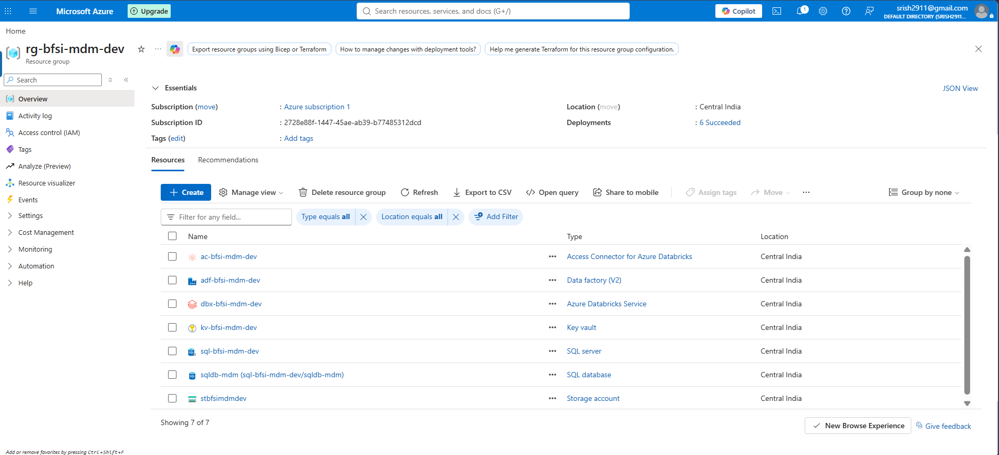

*Evidence: Azure resource group and MDM resources.*

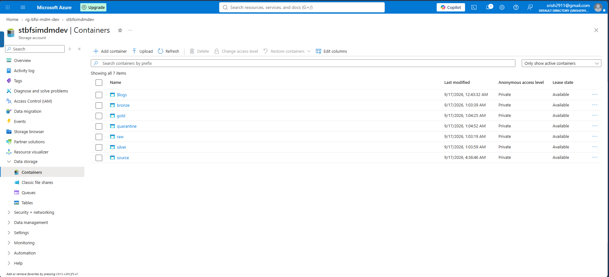

*Evidence: storage containers used by the pipeline.*

---

## Step 3 — Metadata-driven Azure Data Factory ingestion

ADF uses the pipeline `pl_bfsi_mdm_ingest` and the Azure SQL configuration table `dbo.adf_ingestion_control`.

The control table defines the source system, source and target containers/folders/files, load type, enabled state, and load order. The pipeline looks up active configuration rows, loops over the four configured systems, and copies the files to their corresponding `raw/` destinations. The datasets are parameterized, so the same pipeline structure handles Core, CRM, KYC and Wealth.

```text
dbo.adf_ingestion_control
             |
             v
 Lookup active rows
             |
             v
 ForEach configured source
             |
             v
 Copy source file to raw/
```

The ADF managed identity receives the permissions needed for its ingestion and serving operations; it does not require broad database-owner access simply to read the control metadata. The recorded source ingestion run completed successfully for all four Copy activities.

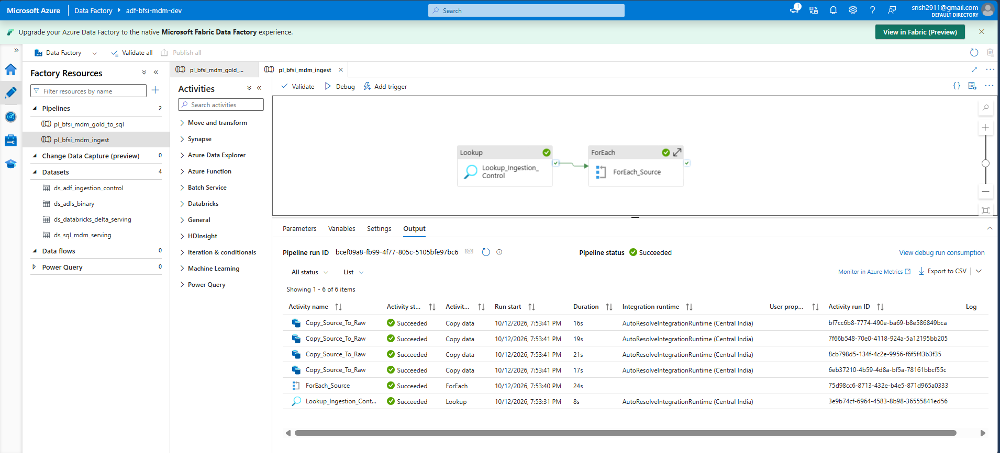

*Evidence: successful metadata-driven ingestion of the configured source files.*

The Gold-to-SQL process is a separate pipeline and is described in [Step 17 — Azure SQL serving layer](#step-17--azure-sql-serving-layer).

---

## Step 4 — Bronze ingestion

**Notebook area:** `notebooks/databricks/MDM_DATAPLATFORM/`

Bronze reads the four raw CSV files using explicit source schemas and writes them into Delta-backed Bronze tables. It adds metadata such as `batch_id`, `ingestion_timestamp`, and `record_hash`, while preserving original source values for later comparison and investigation.

The FULL Bronze population is **2,638,899 records**, matching the source benchmark. Multiline-aware CSV parsing is required because quoted fields can contain embedded newlines. A physical line count is therefore not necessarily a logical row count.

Bronze deliberately does not do identity matching or choose Golden Record winners. It establishes a structured ingestion checkpoint for later stages.

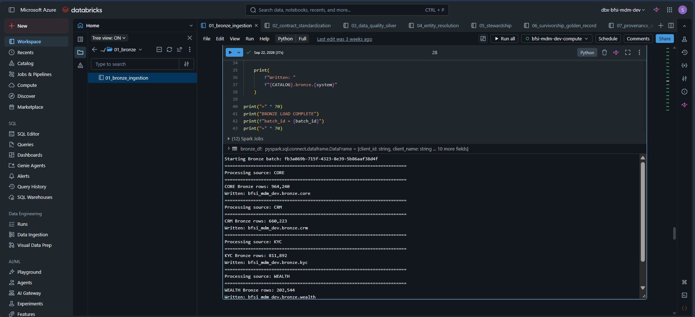

*Evidence: all four source systems loaded to Bronze.*

---

## Step 5 — Contract validation

Each source has a YAML contract under `configs/contracts/`:

- `core.yaml`
- `crm.yaml`
- `kyc.yaml`
- `wealth.yaml`

Contracts describe the expected schema and the rules that the source must meet, including required columns, data types, required/null behavior and configured format or semantic checks. A type-valid field can still be semantically invalid; contract validation is the initial source conformance boundary, not the complete DQ layer.

Invalid rows are written to contract quarantine with their failure context. They are not silently discarded, and the pipeline continues with contract-valid data.

### FULL contract result

| Measure | Rows |
|---|---:|
| Bronze input | 2,638,899 |
| Contract-valid | 2,638,894 |
| Contract quarantine | 5 |

Five records were quarantined by contract validation in the recorded FULL cloud run.

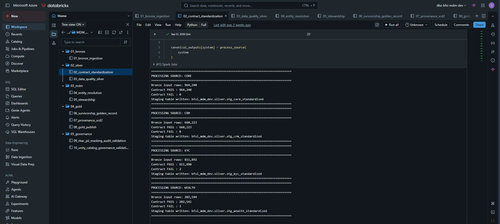

*Evidence: contract validation and downstream standardization output.*

---

## Step 6 — Standardization and canonical representation

The source-specific fields are converted to a common client representation. For example, Core `full_name`, CRM `customer_name`, KYC `legal_name`, and Wealth `client_name` become canonical `name`.

The pipeline preserves both raw and normalized values where comparison requires them:

- `name` / `normalized_name`
- `dob` / `normalized_dob`
- `phone` / `normalized_phone`
- `email` / `normalized_email`
- `address` / `normalized_address`

Source system, source ID and record key are retained for traceability. Other business attributes—such as tax ID, LEI, segment, KYC status, verification date, AUM, risk profile and relationship manager—are mapped when the source schema supplies them. Missing values remain missing instead of being fabricated.

Normalization makes comparable representations easier to match; it does not itself prove the records belong to the same entity.

---

## Step 7 — Data quality and trusted Silver

DQ runs after contract validation and standardization. It checks semantic validity and fitness for matching, including normalized name and identifier presence, phone/email/DOB checks, future DOBs, unrealistic ages, reference data checks, and raw-versus-normalized consistency.

A record can satisfy a schema contract and still fail a semantic DQ rule. Conversely, missing fields that are not applicable to an entity type should not automatically be considered bad data.

### FULL DQ reconciliation

| Source | Input after contract validation | Trusted | DQ quarantine |
|---|---:|---:|---:|
| Core | 964,240 | 964,228 | 12 |
| CRM | 660,223 | 660,214 | 9 |
| KYC | 811,890 | 811,890 | 0 |
| Wealth | 202,541 | 202,537 | 4 |
| **Total** | **2,638,894** | **2,638,869** | **25** |

The recorded 25 DQ-quarantined records failed normalized-email validation. The trusted Silver output is:

`bfsi_mdm_dev.silver.all_clients`

The reconciliation is exact:

```text
2,638,894 contract-valid
= 25 DQ quarantines
+ 2,638,869 trusted Silver records
```

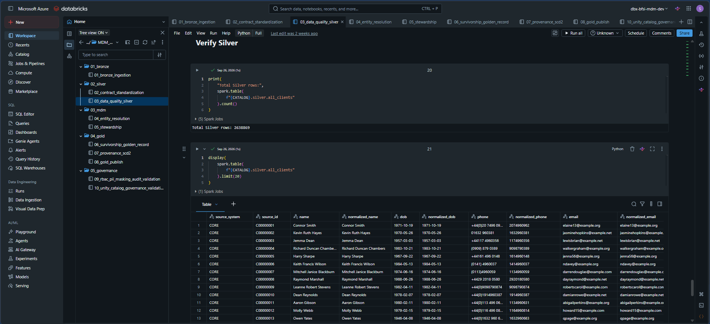

*Evidence: trusted Silver data-quality validation.*

---

## Step 8 — Candidate blocking

A naive all-pairs comparison among 2,638,869 records would involve approximately 3.48 trillion unordered pairs:

\[
\frac{N(N-1)}{2}
\]
That search space is unnecessary for candidate generation. **Blocking** creates a smaller set of plausible pairs sharing selected keys; the matching logic then evaluates those candidate pairs.

The implemented strategies include:

- DOB + postal code
- Surname + DOB
- Normalized email
- Full normalized 10-digit phone key in the final FULL cloud configuration

The final cloud implementation uses a compact key-first approach to reduce shuffle and spill: candidate identifiers are produced first, then enriched with the attribute values used for scoring. A previous shorter phone-suffix strategy generated excessively large candidate populations; the final full-value phone key reduced the candidate population to the recorded size without applying an arbitrary block-size cap.

**FULL result: 138,074,372 candidate pairs.**

Blocking is not a match decision. It is a candidate-generation compromise between compute cost and retaining plausible pairs.

---

## Step 9 — Deterministic matching

Deterministic matching identifies high-confidence pairs using exact agreement on configured combinations of attributes. It is explainable because a rule name describes the condition that fired.

| Rule | Meaning | FULL recorded count |
|---|---|---:|
| `phone_dob_exact` | Exact normalized phone and DOB agreement | 1,961,486 |
| `email_dob_exact` | Exact normalized email and DOB agreement | 70,298 |
| `tax_id_exact` | Exact tax identifier agreement | 14,567 |
| `lei_exact` | Exact legal entity identifier agreement | 1,431 |
| **Total recorded rule counts** |  | **2,047,782** |

Names alone are not sufficiently discriminating to establish identity. Strong identifiers and combinations of evidence reduce the risk of accidental merges. These rule counts describe the recorded cloud execution and should not be interpreted as FULL ground-truth accuracy metrics.

---

## Step 10 — Fuzzy matching and explainable scoring

Deterministic rules cannot capture every legitimate match. Source records may have initials, missing fields, formatting differences or near-matching values. Fuzzy scoring evaluates the candidate pair across multiple attributes.

The FULL cloud implementation uses Spark-native Levenshtein-based similarity so that scoring executes in the distributed environment. The local DEV reference implementation uses RapidFuzz 3.14.6; the two implementations should not be assumed identical without a dedicated comparative evaluation.

### FULL cloud scoring weights

| Attribute | Weight |
|---|---:|
| Name | 35% |
| Phone | 25% |
| Address | 20% |
| Email | 10% |
| DOB | 10% |
| **Total** | **100%** |

The result retains per-attribute scores, aggregate `match_score`, `matching_rule`, `decision`, and a `match_reason`/explanation. That evidence supports debugging and stewardship.

### Decision policy

| Decision | Score threshold | Meaning |
|---|---:|---|
| `MATCH` | `score >= 85` | Automatically accepted candidate edge |
| `REVIEW` | `70 <= score < 85` | Needs human review |
| `NO_MATCH` | `score < 70` | Do not merge this candidate pair |

### FULL candidate-pair distribution

| Decision | Count | Share of candidate pairs |
|---|---:|---:|
| MATCH | 2,249,077 | 1.6289% |
| REVIEW | 159,560 | 0.1156% |
| NO_MATCH | 135,665,735 | 98.2556% |
| **Total** | **138,074,372** | **100%** |

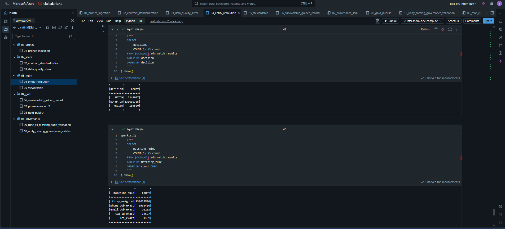

*Evidence: the distributed entity-resolution decision counts and matching rules.*

### Accuracy metrics: DEV versus FULL

The local DEV configuration previously measured:

| DEV metric | Result |
|---|---:|
| Precision | 99.9926% |
| Recall | 97.4423% |
| F1 | 98.7010% |
| Blocking recall | 99.4769% |

These are **DEV benchmark results only**. A full Precision/Recall/F1 claim for the FULL cloud configuration requires evaluating that configuration against the isolated FULL ground truth. The candidate distribution by itself does not establish the factual accuracy of the decisions.

---

## Step 11 — Human stewardship

Pairs in the REVIEW band are deliberately not merged automatically. A steward should inspect the records, compare the match evidence, make a decision and provide a reason.

A stewardship case tracks the candidate pair, case status, decision, steward ID, decision reason, and decision timestamp. Case IDs are derived deterministically from the canonical pair of record keys, so the same pair can be referenced consistently when pair ordering is canonicalized.

### Review lifecycle

```text
REVIEW candidate
      |
      v
OPEN stewardship case
      |
      +---- APPROVE_MATCH ----> RESOLVED
      |                          |
      |                          v
      |                   Accepted graph edge
      |
      +---- REJECT_MATCH -----> RESOLVED
                                 |
                                 v
                         Excluded from graph
```

The API checks for an existing decision within its transaction. A duplicate resolution returns HTTP 409 instead of silently overwriting the prior decision. An accepted review edge is created only from an explicit `APPROVE_MATCH` decision. A rejection, unresolved review case, or NO_MATCH pair is not an accepted edge.

### Recorded review checkpoint

- REVIEW cases: **159,560**
- Persisted decisions: **2**
  - `1 × APPROVE_MATCH`
  - `1 × REJECT_MATCH`
- Accepted manual review edges: **1**

This point-in-time checkpoint does not mean all review cases were manually reviewed.

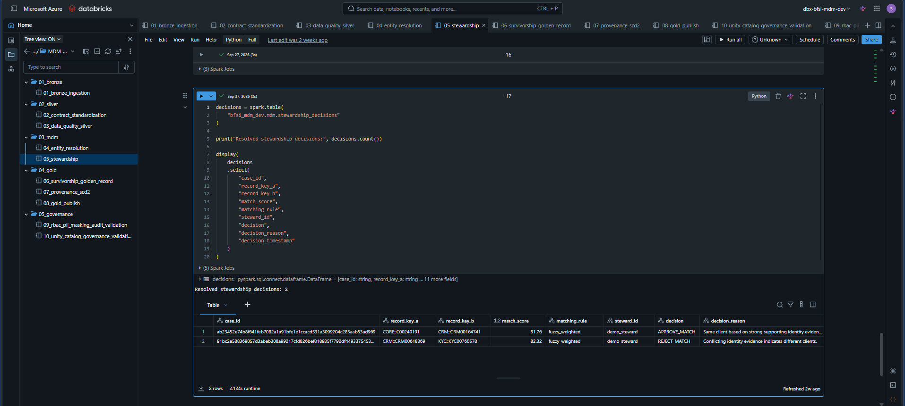

*Evidence: recorded stewardship decision results.*

---

## Step 12 — Clustering and master identity

Pairwise edges must be converted into identity groups because one real client can have records in three or four systems. The mastering stage uses **connected components** over the accepted identity graph.

Only these edges enter the accepted graph:

- Automatic `MATCH` results.
- Explicitly approved stewardship decisions (`APPROVE_MATCH`).

The graph excludes `REJECT_MATCH`, unresolved REVIEW and `NO_MATCH` pairs.

For example:

```text
A --- B --- C

D --- E

F
```

The first three records form one component, D and E form another, and F is a valid singleton component. Accepted edges imply transitive group membership; a direct A–C edge is not required if the accepted path connects them.

The FULL cloud implementation used distributed iterative label propagation and converged in five iterations for the recorded graph. Every trusted source record was mapped into the resulting master population:

| Mastering validation | Result |
|---|---:|
| Trusted Silver records | 2,638,869 |
| Source records mapped | 2,638,869 |
| Null master IDs | 0 |
| Distinct master clients | 1,080,592 |

`MASTER_CLIENT_ID` identifies the mastered entity; it is distinct from the hidden benchmark-only `entity_key`.

The master registry maps:

```text
SOURCE_SYSTEM::SOURCE_ID -> MASTER_CLIENT_ID
```

Registry reuse logic exists, but cross-run identifier stability has not been empirically demonstrated by the initial FULL run.

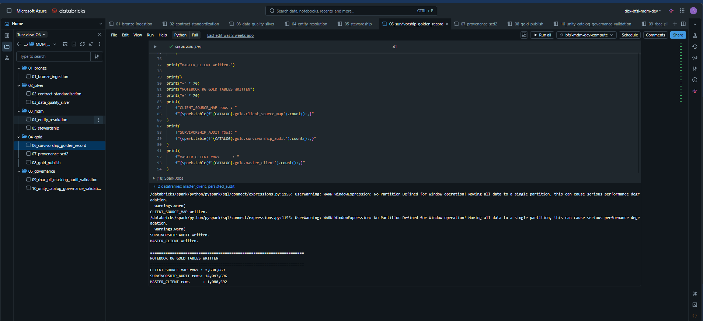

*Evidence: mastered Golden Record and source-map outputs.*

---

## Step 13 — Attribute-level survivorship and Golden Records

A Golden Record should not simply copy one entire source row. The most authoritative name might come from KYC, while the best email may come from Core and the segment may come from CRM. The platform therefore performs survivorship independently for each attribute.

### Project-defined source authority

| Source | Authority score |
|---|---:|
| KYC | 4 |
| Core | 3 |
| CRM | 2 |
| Wealth | 1 |

This is the project's configured policy, not a universal banking standard. The ranking dimensions include source authority, verification, recency, completeness, match confidence, and deterministic tie-breakers. Verification is based on the presence of `verification_date`; the documented fallback for missing recency is `1900-01-01`.

### Thirteen Golden Record attributes

1. `name`
2. `dob`
3. `phone`
4. `email`
5. `address`
6. `tax_id`
7. `lei`
8. `segment`
9. `kyc_status`
10. `verification_date`
11. `aum`
12. `risk_profile`
13. `relationship_manager`

The initial FULL run produced **1,080,592 Golden Records**. The selected values are supported by attribute-level source provenance and survivorship reasoning.

---

## Step 14 — Provenance, source mapping, and SCD Type 2 history

Current values answer “what is the mastered value now?” Provenance and history address “where did it come from?”, “why did it win?”, and “what versions have been recorded?”

### Gold mastering outputs

| Output | Responsibility | Recorded row count |
|---|---|---:|
| `MASTER_CLIENT` | Current Golden Record | 1,080,592 |
| `CLIENT_SOURCE_MAP` | Source system/ID to master mapping | 2,638,869 |
| `MASTER_CLIENT_ATTRIBUTE` | Attribute value, winning source and survivorship reason | 14,047,696 |
| `SURVIVORSHIP_AUDIT` | Attribute-level survivorship audit | 14,047,696 |
| `MASTER_CLIENT_HISTORY` | SCD Type 2 attribute history | 14,047,696 |

The three attribute-level outputs have a grain of one row per master per Golden Record attribute:

```text
1,080,592 master records × 13 attributes = 14,047,696 rows
```

### SCD Type 2 behavior

The history model stores `master_client_id`, attribute/field, value, `effective_date`, `expiry_date`, and `is_current`. On an initial load, every mastered attribute receives a current history version.

The implemented change-handling logic is designed to:

1. Keep an existing current row when a value is unchanged.
2. Expire an old version and create a new current version when a value changes.
3. Create a current version when a value first appears.
4. Expire a previous version when a value is no longer populated.

### What the initial FULL run proves

| Initial SCD2 validation | Result |
|---|---:|| History rows | 14,047,696 |
| Current rows | 14,047,696 |
| Expired rows | 0 |
| Validation | PASS |

Zero expired rows is expected for an initial load. A subsequent changed-value run has not been verified as evidence of an actual expiry transition.

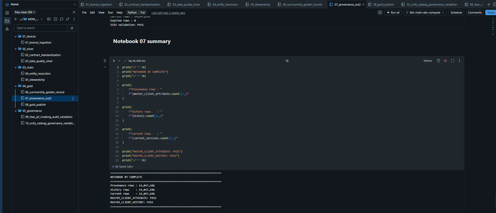

*Evidence: provenance and initial SCD2 history validation.*

---

## Step 15 — Gold certification and publication

The `08_gold_publish` stage validates the Gold publication boundary after mastering. The checks include:

- Required output tables exist.
- Master identifiers are unique.
- Source-to-master mappings are unique and cover the trusted Silver population.
- Provenance and survivorship audit outputs are complete.
- Current-history invariants hold for each master/attribute.
- Gold table references and row-count relationships are valid.

The recorded FULL publication audit reports:

```text
Publication status: SUCCESS
Validation status:  ALL_GOLD_VALIDATIONS_PASSED
```

Publication audit evidence is persisted in `bfsi_mdm_dev.audit.pipeline_run_audit`. It is the hand-off signal that downstream serving should consume the certified data, not an intermediate notebook output.

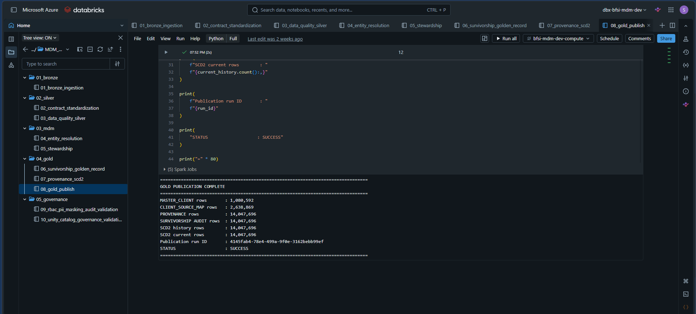

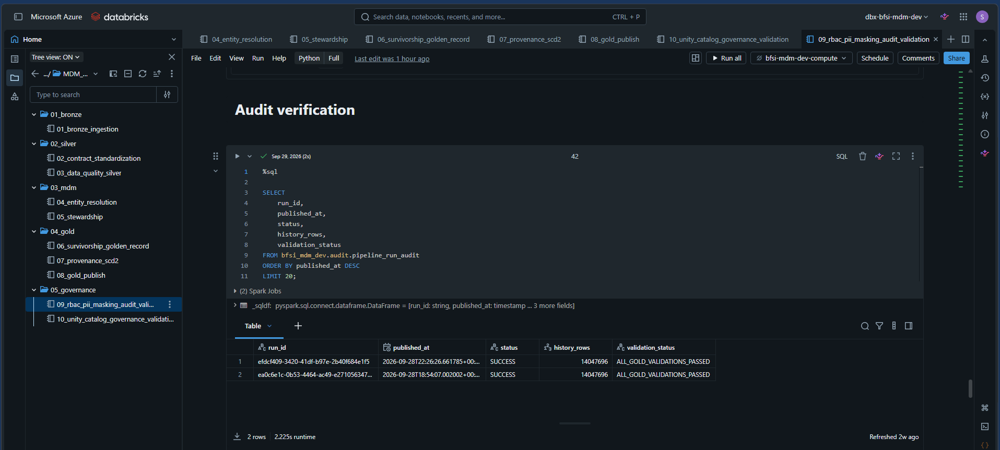

*Evidence: successful Gold publication and recorded pipeline validation.*

---

## Step 16 — Unity Catalog governance and security

Unity Catalog is the Databricks governance control plane across Bronze, Silver, MDM, Gold, quarantine, and audit data. The implemented catalog is `bfsi_mdm_dev`; its schemas include `bronze`, `silver`, `gold`, `mdm`, `quarantine`, and `audit`.

### Role-based groups

| Group | Purpose |
|---|---|
| `mdm_engineers` | Engineering and development access |
| `mdm_stewards` | Stewardship/investigation access |
| `mdm_analysts` | Governed analytical consumption |
| `mdm_pii_access` | Explicit access to original PII values through the configured masking rules |

Access is scoped through catalog, schema, and table permissions. Readers need the applicable namespace privileges as well as the data privilege. The analyst role is not granted broad modification rights merely because it needs to consume data.

### PII tags and masking

The project classifies sensitive fields such as name, phone, email, address, Tax ID and financial AUM. Three documented masking functions handle email, phone, and Tax ID:

- `bfsi_mdm_dev.gold.mask_email`
- `bfsi_mdm_dev.gold.mask_phone`
- `bfsi_mdm_dev.gold.mask_tax_id`

For readers without `mdm_pii_access`, those functions return masked values. Authorized readers receive the original values. This is different from a sensitivity tag: tags classify data, while masking changes what an unauthorized reader sees.

The serving ADF managed identity has explicit membership in `mdm_pii_access` because the approved Gold-to-SQL transfer must read original governed values rather than accidentally publishing masked representations as if they were source values.

### Lineage and audit boundaries

Catalog Explorer lineage for `bfsi_mdm_dev.gold.master_client` was verified, and the pipeline-run audit is available in the MDM audit table. Direct SQL queries against Databricks `system.access.table_lineage`, `system.access.column_lineage`, and `system.access.audit` were permission-limited and are not claimed as verified.

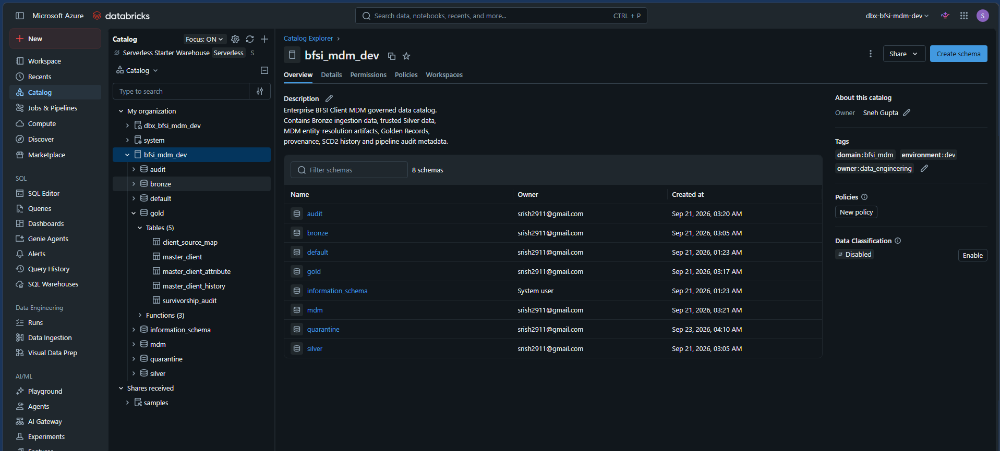

*Evidence: Unity Catalog MDM catalog and schema organization.*

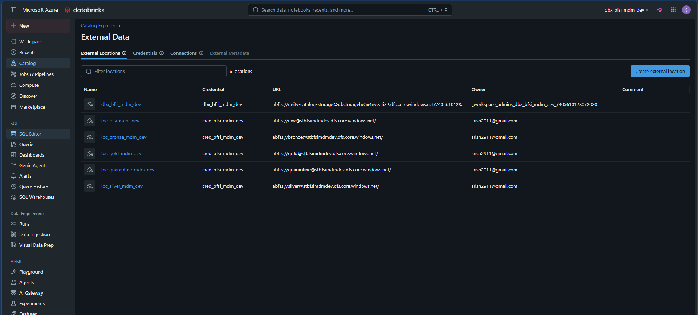

*Evidence: configured governed storage access.*

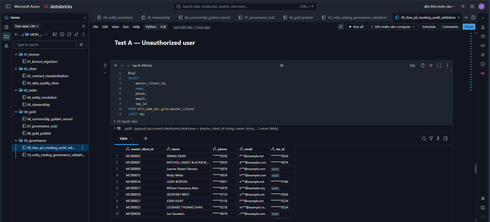

*Evidence: restricted-user masking behavior.*

---

## Step 17 — Azure SQL serving layer

Azure SQL is the relational serving boundary for client searches, Golden Record retrieval, stewardship workflows, and dashboard aggregates. It does not rerun Spark matching or clustering.

ADF pipeline `pl_bfsi_mdm_gold_to_sql` transfers the curated Gold outputs and supporting operational tables into the `mdm` schema. The recorded pipeline run completed all nine serving Copy activities successfully.

### Nine-table serving model

| Azure SQL table | Consumer / purpose | Recorded rows |
|---|---|---:|
| `mdm.master_client` | Current Golden Records | 1,080,592 |
| `mdm.client_source_map` | Source-to-master mapping | 2,638,869 |
| `mdm.client_record` | Canonical trusted source records | 2,638,869 |
| `mdm.match_review` | REVIEW candidates and matching evidence | 159,560 |
| `mdm.stewardship_case` | Review state and decision status | 159,560 |
| `mdm.stewardship_decision` | Persisted decisions | 2 |
| `mdm.pipeline_run` | Latest publication metadata | 1 |
| `mdm.platform_health` | Data-quality and platform metrics | 9 |
| `mdm.entity_resolution_summary` | Aggregated decision metrics | 3 |

The view `mdm.v_pending_match_review` exposes cases that have not been resolved, by combining review evidence with case status. The schema contains indexes to support common client/source lookups, review queues, and run filters.

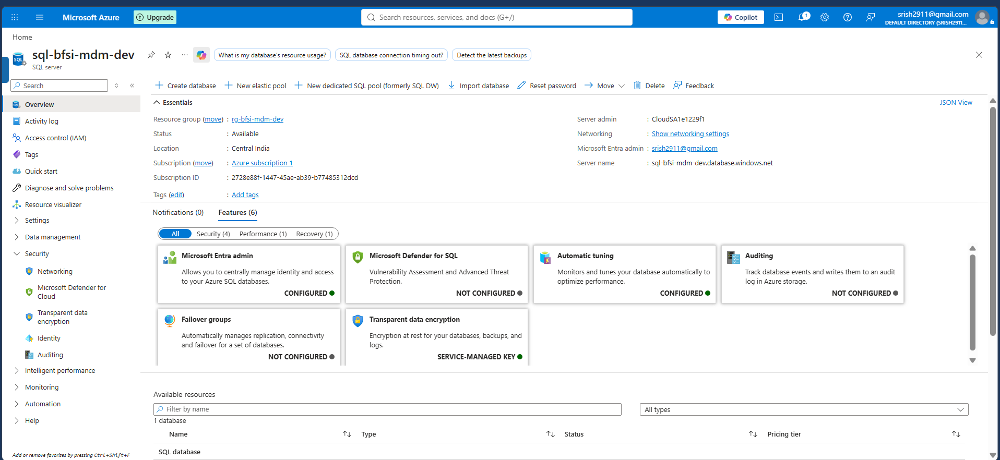

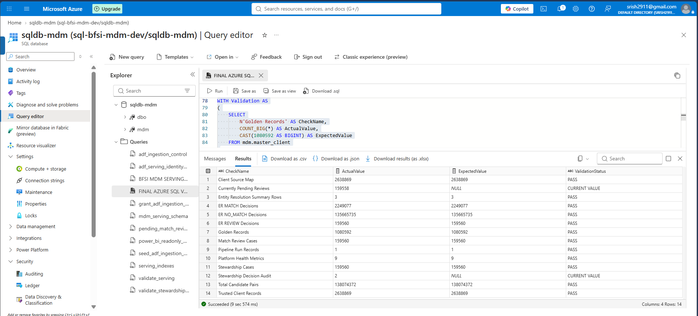

*Evidence: Azure SQL serving and final validation.*

---

## Step 18 — FastAPI serving API

The API is in `apps/api/`:

- `main.py` defines routes and the stewardship decision workflow.
- `db.py` configures SQLAlchemy/pyodbc and Azure credential-based database access.
- `schemas.py` defines Pydantic request/response models.

The database path is:

```text
FastAPI -> SQLAlchemy -> pyodbc -> ODBC Driver 18 -> Azure SQL
```

Authentication uses `DefaultAzureCredential` and Microsoft Entra identity, rather than embedding a SQL username/password in the API code. A live `/health` request performs a database `SELECT 1` check; it therefore requires connectivity and adequate Azure SQL permissions.

### Implemented endpoints

| Method | Endpoint | Purpose |
|---|---|---|
| GET | `/health` | Database connectivity check |
| GET | `/clients/search` | Search Golden Records |
| GET | `/clients/{master_client_id}` | Retrieve one master |
| GET | `/clients/{master_client_id}/sources` | Retrieve source records for a master |
| GET | `/matches/pending` | Retrieve bounded pending review queue |
| GET | `/matches/{case_id}` | Retrieve case, evidence, status and source records |
| POST | `/matches/{case_id}/approve` | Persist `APPROVE_MATCH` |
| POST | `/matches/{case_id}/reject` | Persist `REJECT_MATCH` |

Query limits and request fields are validated. The approval/rejection transaction checks for an earlier decision, updates the case to `RESOLVED`, persists the decision reason/steward/timestamp, and inserts an audit row. Duplicate decisions are rejected with HTTP 409. The regression tests mock the database operations; they do not issue destructive decisions to the live serving database.

When the API is running locally, interactive documentation is available at [`http://127.0.0.1:8000/docs`](http://127.0.0.1:8000/docs).

[Open the FastAPI walkthrough PDF](application_pdfs/FastAPI/BFSI_Client_MDM_API_FastAPI.pdf).

---

## Step 19 — Streamlit operations UI

Streamlit is the browser-facing application in `apps/streamlit/app.py`. It calls FastAPI over HTTP and does not open a direct database connection.

### Client Search

Search published Golden Records by master ID, name prefix, email, or phone. Results show useful identifying and summary attributes such as name, DOB, contact information, segment and KYC status.

[Open the Client Search walkthrough PDF](application_pdfs/Streamlit/BFSI_Client_MDM_Streamlit_Client_Search.pdf).

### Golden Record

Load a record by `MASTER_CLIENT_ID`, inspect the mastered fields, and view the trusted source records mapped to that master. This lets the user understand how the enterprise identity is supported by its source-system data.

[Open the Golden Record walkthrough PDF](application_pdfs/Streamlit/BFSI_Client_MDM_Streamlit_Golden_Record.pdf).

### Match Review

Select a pending case or load a specific case ID, inspect the matching rule and score evidence, compare both source records, then submit approval or rejection with a steward ID and reason.

A recorded fresh API GET for a particular approved case returned `RESOLVED / APPROVE_MATCH`. The final same-case Streamlit check was still listed as pending in the handoff: loading that exact case in the UI should display `RESOLVED`. A success banner paired with a different currently selected queue case does not prove a refresh defect because the IDs differ.

[Open the Match Review walkthrough PDF](application_pdfs/Streamlit/BFSI_Client_MDM_Streamlit_Match_Review.pdf).

---

## Step 20 — Power BI reporting

The report intentionally has two business/operational pages:

1. **Platform Health**
2. **Entity Resolution**

It imports only four serving tables—not all 138 million candidate pairs:

- `mdm.platform_health` — 9 rows
- `mdm.pipeline_run` — 1 row
- `mdm.match_review` — 159,560 rows
- `mdm.entity_resolution_summary` — 3 rows

### Platform Health

The dashboard displays source record volume, contract pass/quarantine, DQ quarantine, trusted Silver records, master clients, accepted identity edges, candidate pairs, latest publication status and latest validation status.

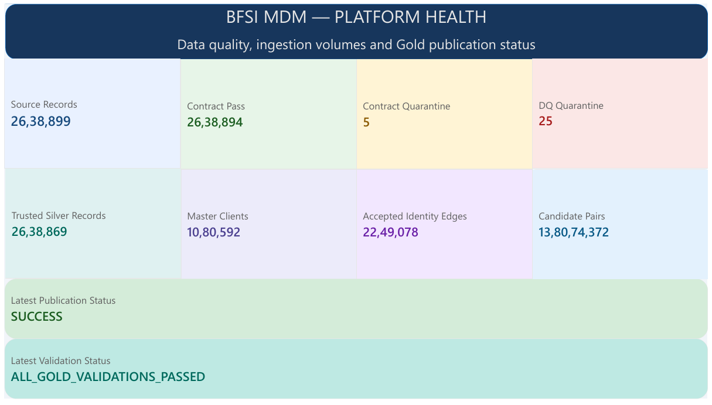

### Entity Resolution

The dashboard shows candidate-pair and decision KPIs, MATCH/REVIEW rates, a decision-distribution chart, average match score by decision, and a Top 50 worklist ordered by score.

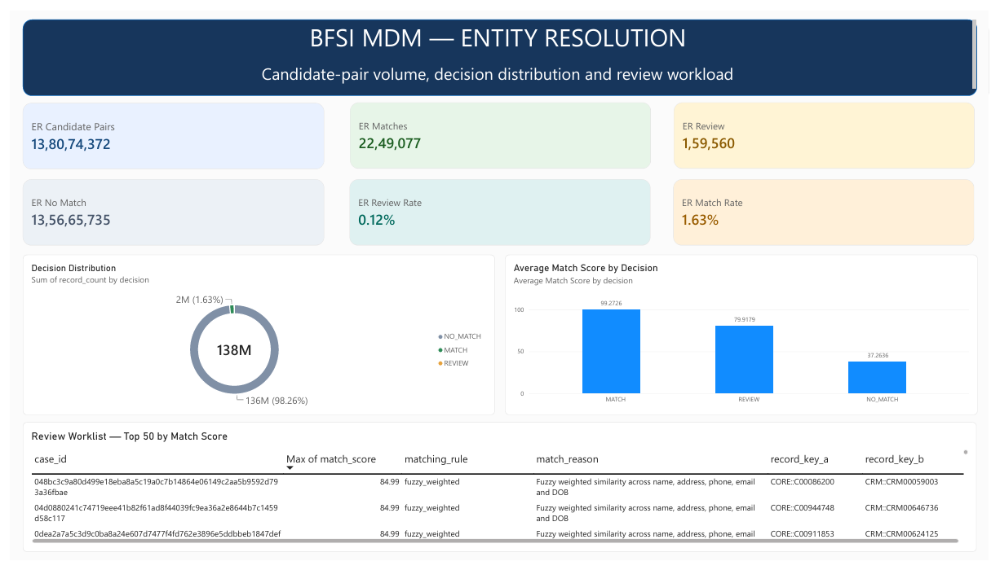

### Model design and validation

The model uses `run_id` relationships from `pipeline_run` to `platform_health` and `entity_resolution_summary`. Because the total candidate-pair count is repeated across the three decision-summary rows, the measure uses the maximum rather than summing the same total three times.

The `TEMP - Validation` page was a verification page used to capture row-count evidence; it is not a third dashboard. The `.pbix` is intentionally excluded from Git because it may embed imported data. The repository carries the PDF export and screenshots.

[Open the Power BI report PDF](reports/powerbi/enterprise_bfsi_mdm_powerbi.pdf).

---

## Testing and GitHub Actions

The repository contains tests for contract validation, standardization, DQ, blocking, deterministic matching, fuzzy scoring, survivorship/SCD2 and API behavior.

### Recorded local checks

```powershell
python -m compileall -q apps src tests
python -m pytest tests/test_api.py -q
python -m pytest -q
```

Recorded results:

```text
API regression tests: 8 passed
Full pytest suite:    55 passed, 1 warning
Python compilation:   passed
```

The warning was a non-blocking Starlette deprecation warning related to the installed TestClient HTTP client integration. The tests passed.

API test cases cover request/query validation, response structure, approval persistence operations, duplicate-decision HTTP 409, missing-case behavior, and returned resolved status. Database operations are mocked to avoid live Azure dependencies and live stewardship mutations.

### GitHub Actions CI

Workflow file: `.github/workflows/ci.yml`

- Triggers on pushes to `main`, pull requests to `main`, and manual workflow dispatch.
- Runs on `ubuntu-latest` with Python 3.11.
- Installs project dependencies and ODBC system dependencies.
- Runs `compileall` and pytest.
- Uses read-only repository content permissions.
- Does **not** deploy to Azure.
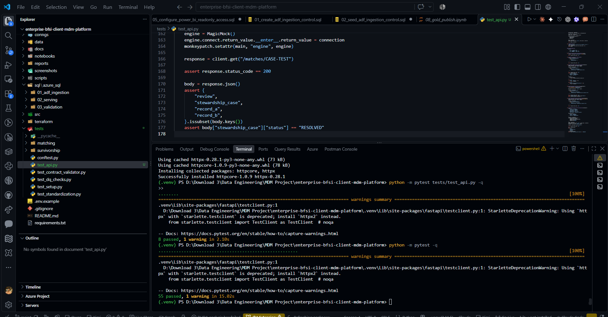

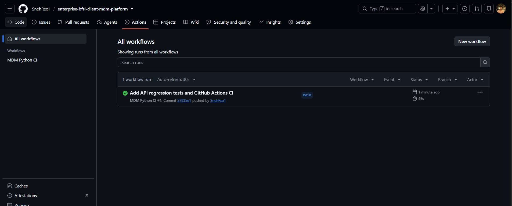

[View GitHub Actions runs](https://github.com/SnehRex1/enterprise-bfsi-client-mdm-platform/actions).

---

## Repository layout

This is a focused tree of the important tracked project areas. Generated benchmark data and the editable PBIX are excluded from the public repository.

```text
enterprise-bfsi-client-mdm-platform/
├── .github/
│   └── workflows/
│       └── ci.yml
├── architecture/
│   └── Enterprise BFSI Client MDM Platform - Architecture Diagram.png
├── application_pdfs/
│   ├── FastAPI/
│   │   └── BFSI_Client_MDM_API_FastAPI.pdf
│   └── Streamlit/
│       ├── BFSI_Client_MDM_Streamlit_Client_Search.pdf
│       ├── BFSI_Client_MDM_Streamlit_Golden_Record.pdf
│       └── BFSI_Client_MDM_Streamlit_Match_Review.pdf
├── apps/
│   ├── api/
│   │   ├── db.py
│   │   ├── main.py
│   │   └── schemas.py
│   └── streamlit/
│       └── app.py
├── configs/
│   ├── contracts/
│   ├── canonical_mapping.yaml
│   ├── survivorship.yaml
│   ├── config.yaml
│   └── simulator.yaml
├── docs/
│   ├── DATA_DICTIONARY.md
│   ├── PHASE3_ENTITY_RESOLUTION.md
│   ├── PHASE5_SURVIVORSHIP_GOLDEN_RECORD.md
│   ├── data-model.md
│   ├── data_contracts.md
│   ├── entity-resolution.md
│   ├── governance.md
│   ├── phase1_benchmark.md
│   └── phase2_data_quality.md
├── notebooks/
│   └── databricks/
│       └── MDM_DATAPLATFORM/
│           ├── 01_bronze/
│           ├── 02_silver/
│           ├── 03_mdm/
│           ├── 04_gold/
│           └── 05_governance/
├── reports/
│   └── powerbi/
│       └── enterprise_bfsi_mdm_powerbi.pdf
├── screenshots/
│   ├── 01_Azure_Infrastructure_and_Storage/
│   ├── 02_Azure_Data_Factory/
│   ├── 03_Databricks_Data_Processing_and_MDM/
│   ├── 04_Unity_Catalog_Governance/
│   ├── 05_Azure_SQL_Serving/
│   ├── 06_Power_BI_Dashboards/
│   ├── 07_Validation_and_Operations/
│   └── 08_CI_and_Acceptance/
├── scripts/
├── sql/
│   └── azure_sql/
│       ├── 01_adf_ingestion/
│       ├── 02_serving/
│       └── 03_validation/
├── src/
│   ├── matching/
│   ├── quality/
│   ├── standardization/
│   ├── survivorship/
│   └── utils/
├── terraform/
├── tests/
│   ├── matching/
│   ├── survivorship/
│   ├── conftest.py
│   ├── test_api.py
│   ├── test_contract_validator.py
│   ├── test_dq_checks.py
│   ├── test_setup.py
│   └── test_standardization.py
├── .env.example
├── .gitignore
├── README.md
└── requirements.txt
```

**Note:** the folders within `notebooks/databricks/MDM_DATAPLATFORM/` organize Databricks notebook artifacts in the project/workspace layout. Check the tracked tree for the exact serialized notebook filenames.

---

## Run the local tests and applications

### Prerequisites

- Git
- Python 3.11 (the CI interpreter version)
- Azure CLI and an authorized Microsoft Entra identity for live Azure SQL access
- Microsoft ODBC Driver 18 for SQL Server for database-backed API use
- Azure resources already provisioned/configured for live serving

The mocked API tests do not need access to Azure SQL.

### 1. Clone the repository

```powershell
git clone https://github.com/SnehRex1/enterprise-bfsi-client-mdm-platform.git
cd enterprise-bfsi-client-mdm-platform
```

### 2. Create a virtual environment

```powershell
py -3.11 -m venv .venv
.\.venv\Scripts\Activate.ps1
python -m pip install --upgrade pip
python -m pip install -r requirements.txt
```

If PowerShell blocks activation under your local execution policy, follow your organization's policy or invoke the virtual environment's Python executable directly rather than changing system-wide security settings.

### 3. Run the test suite

```powershell
python -m compileall -q apps src tests
python -m pytest tests/test_api.py -q
python -m pytest -q
```

Expected recorded results for the validated checkpoint are 8 API tests and 55 tests overall. New repository changes can alter those results, so treat the commands—not the historical numbers—as the current test.

### 4. Configure and start FastAPI

The current database code uses `DefaultAzureCredential` and SQLAlchemy/pyodbc. Set the SQL server/database for your own authorized environment and sign in through Azure CLI. Do not place credentials in source control.

```powershell
$env:MDM_SQL_SERVER = "<your-server>.database.windows.net"
$env:MDM_SQL_DATABASE = "<your-database>"
az login
python -m uvicorn apps.api.main:app --reload
```

Open:

- API: `http://127.0.0.1:8000`
- Swagger UI: `http://127.0.0.1:8000/docs`

A successful `/health` response requires that the API can actually connect to Azure SQL using the configured identity and permissions.

### 5. Start Streamlit

In a second terminal using the same virtual environment:

```powershell
$env:MDM_API_URL = "http://127.0.0.1:8000"
python -m streamlit run apps/streamlit/app.py
```

Open the local URL printed by Streamlit. Database-backed search and review actions require FastAPI to be running and configured for the serving database.

### 6. Power BI

The tracked repository includes the PDF report and supporting screenshots. The editable `.pbix` is deliberately excluded by `.gitignore` because imported data may be embedded in the file. Use the authorized local PBIX and SQL connection to refresh or edit the report.

---

## Documentation and evidence index

### Technical documents

- [Phase 1 benchmark manifest](docs/phase1_benchmark.md) — source populations, filters, schemas, deterministic seed, simulator stats and freeze policy.
- [Phase 2 contracts, standardization and DQ](docs/phase2_data_quality.md) — contracts, canonical mappings, quarantine, and validation.
- [Phase 3 entity resolution](docs/PHASE3_ENTITY_RESOLUTION.md) — matching strategy and DEV evaluation.
- [Phase 5 survivorship, Golden Record, provenance and SCD2](docs/PHASE5_SURVIVORSHIP_GOLDEN_RECORD.md).
- [Data contracts](docs/data_contracts.md).

The README above consolidates the architecture, data model, results, application interfaces, governance and evidence. Some other tracked docs may be scaffolded placeholders; they should not be relied on for substantive detail unless populated.

### Full evidence folders

- [Azure infrastructure and storage](screenshots/01_Azure_Infrastructure_and_Storage/)
- [Azure Data Factory](screenshots/02_Azure_Data_Factory/)
- [Databricks processing and MDM](screenshots/03_Databricks_Data_Processing_and_MDM/)
- [Unity Catalog governance](screenshots/04_Unity_Catalog_Governance/)
- [Azure SQL serving](screenshots/05_Azure_SQL_Serving/)
- [Power BI dashboards](screenshots/06_Power_BI_Dashboards/)
- [Validation and operations](screenshots/07_Validation_and_Operations/)
- [Phase 13 CI and acceptance](screenshots/08_CI_and_Acceptance/)

---

## Known limitations and claims boundary

- **Synthetic benchmark only:** no actual bank customer data is used.
- **FULL accuracy:** DEV Precision/Recall/F1 must not be reported as FULL cloud accuracy. FULL decision counts are known; a FULL hidden-ground-truth accuracy evaluation is not verified.
- **Stewardship:** the recorded checkpoint has two persisted review decisions, not 159,560 manually reviewed decisions.
- **SCD2:** the initial FULL load has 14,047,696 current rows and zero expired rows. Actual expiry after a changed-value subsequent run is not verified.
- **Master-ID stability:** registry reuse is implemented as a design, but cross-run stability was not empirically demonstrated by the initial FULL run.
- **Unity Catalog platform audit:** Catalog Explorer lineage and the pipeline audit were verified; direct `system.access` SQL queries were permission-limited.
- **CI versus CD:** GitHub Actions compiles and tests the code; it does not deploy to Azure.
- **Power BI artifact:** PDF and screenshots are tracked; the editable `.pbix` remains excluded from Git because it may contain imported data.
- **Production readiness:** real-data onboarding would require separate validation of security controls, service availability, observability, release process, networking, data protection, and regulatory obligations.

---

## Security and cost controls

- Never commit `.env`, passwords, access tokens, service-principal secrets, connection strings with credentials, private source data, or hidden ground truth.
- Use Microsoft Entra authentication and managed identities where configured; grant only the permissions required for the identity's role.
- Keep the editable PBIX outside the public repository unless its embedded data has been deliberately reviewed and cleared for publication.
- Review screenshots and PDFs for account emails, tokens, private resource details, or other sensitive material before publishing.
- Use DEV for routine iterations and plan FULL processing as an acceptance-scale operation.
- Stop or terminate compute when it is not needed.
- Back up evidence and required outputs before deleting resources. Do not execute `terraform destroy` or delete Azure resources until the cleanup scope has been reviewed explicitly.

---

## Acknowledgements

- [Banking Digital Twin](https://github.com/meetnishant/BankingDigitalTwin) — synthetic individual/customer foundation.
- [GLEIF](https://www.gleif.org/) — legal-entity reference data.

---

**Project:** Enterprise BFSI Client MDM & Data Governance Platform  
**Architecture:** Frozen V4 reference design  
**Data path:** Azure Data Factory → ADLS Gen2 → Databricks/PySpark + Delta Lake → Unity Catalog governance → Azure SQL → FastAPI / Streamlit / Power BI  
**Matching:** Deterministic rules + fuzzy/explainable scoring; no ML/LLM matching  
**Ground truth:** Isolated benchmark truth used for evaluation only, never as a matching input